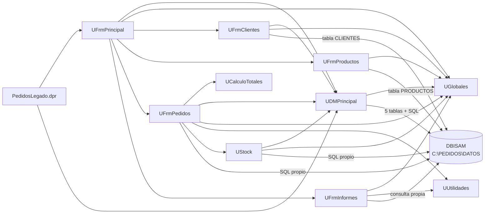

# Dependencias de Pedidos Legado

<!--
Etapa 1 · Entender (plan mode).
Dibuja quién usa a quién: unidades, formularios y la base de datos.
- Una flecha A --> B significa «A usa a B» (lo ves en la cláusula uses o en una consulta SQL).
- Incluye la base de datos (DBISAM) como un nodo: es parte del sistema.
Punto de control E1: el diagrama incluye la base de datos.
-->

Sacado de las cláusulas `uses` (interface e implementation) de cada `.pas` y del `.dpr`. Las flechas a la base salen de quien abre tablas o ejecuta SQL; no se dibujan las unidades estándar de Delphi (`SysUtils`, `Forms`, `DB`…).

`PedidosLegado.dpr` declara las 10 unidades en su `uses`, pero solo crea `UDMPrincipal` y `UFrmPrincipal` al arrancar (`legado/PedidosLegado.dpr:21-22`); el diagrama muestra esas dos flechas.

## Preguntas guía

1. **¿Qué unidad usan casi todas las demás? ¿Qué pasaría si cambia?**
   `UGlobales`: la usan 7 de las otras 9 unidades (todas menos `UCalculoTotales` y `UUtilidades`). Guarda estado mutable compartido (usuario, nivel, IVA, flete, ruta de datos) que varios formularios modifican (`legado/src/UGlobales.pas:3-4`). Cambiarla afecta a casi todo el sistema, y al migrar ese estado global tiene que pasar a configuración y sesión explícitas.
   En segundo lugar está `UDMPrincipal` (4 unidades): es la única puerta «oficial» a la base, pero `UFrmPedidos`, `UStock`, `UFrmClientes`, `UFrmProductos` y `UFrmInformes` también abren tablas o consultas propias.

2. **¿Qué unidad no depende de formularios ni de la base de datos? ¿Por qué eso importa para migrar?**
   `UGlobales` no depende de nada (no tiene cláusula `uses`). `UCalculoTotales` y `UUtilidades` solo usan la biblioteca estándar (`SysUtils`, `DateUtils`): no tocan formularios, base ni globales. Son lógica pura que se puede migrar y probar con tests sin levantar la base ni la interfaz, por eso son el mejor punto de partida para llevar reglas a `PedidosWeb.Core`.
