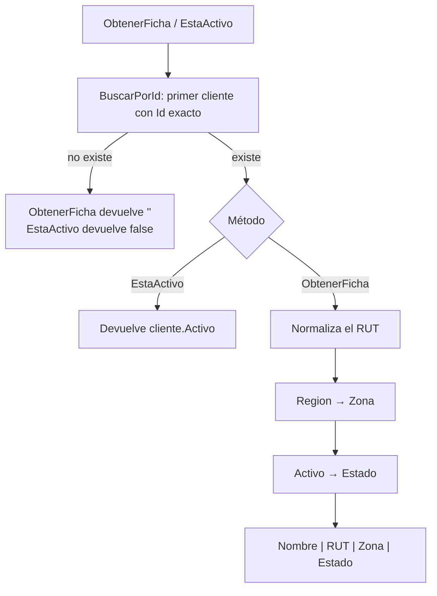

# ClientesService

## Propósito

`ClientesService` (`src/PedidosWeb.Core/Clientes/ClientesService.cs`) consulta los clientes de la distribuidora y expone dos operaciones de lectura: la ficha de un cliente lista para mostrar en pantalla y si un cliente está activo. Trabaja sobre una lista de `Cliente` en memoria; todavía no hay base de datos.

## API pública

### Constructores

| Constructor | Comportamiento |
|---|---|
| `ClientesService()` | Usa los 8 clientes ficticios de `ClientesDeEjemplo.Crear()` (`C-001` a `C-008`). |
| `ClientesService(List<Cliente> clientes)` | Usa la lista recibida. |

### Métodos

| Método | Devuelve | Descripción |
|---|---|---|
| `ObtenerFicha(string id)` | `string` | Texto `Nombre \| RUT \| Zona \| Estado`. Devuelve `""` si el cliente no existe. |
| `EstaActivo(string id)` | `bool` | `true` solo si el cliente existe y `Activo` es `true`. |

### Formato de la ficha

- **RUT**: se quitan los puntos y los espacios y se pasa a mayúsculas (`76.990.011-k` → `76990011-K`).
- **Zona**, según `Cliente.Region`:

  | Región | Zona |
  |---|---|
  | `RM`, `V` | `Zona centro` |
  | `VIII` | `Zona sur` |
  | `II` | `Zona norte` |
  | cualquier otra | `Sin zona` |

- **Estado**: `Activo` o `Inactivo`.

La búsqueda por `id` es exacta (sin normalizar mayúsculas ni espacios) y toma el primer cliente que coincide.

## Ejemplo de uso

Los datos salen de `tests/PedidosWeb.Core.Tests/Clientes/ClientesServiceTests.cs`.

```csharp
var servicio = new ClientesService();

servicio.ObtenerFicha("C-001");
// "Ferretería El Clavo | 76123456-0 | Zona centro | Activo"

servicio.ObtenerFicha("C-004");
// "Almacén La Esquina | 76990011-K | Zona centro | Activo"  (RUT original: "76.990.011-k")

servicio.ObtenerFicha("C-999");
// ""  (cliente inexistente)

servicio.EstaActivo("C-001"); // true
servicio.EstaActivo("C-007"); // false (cliente inactivo)
servicio.EstaActivo("C-999"); // false (cliente inexistente)
```

## Diagrama



## Observaciones

Rarezas del código actual; no se han corregido.

- La clase no es `sealed`, a diferencia de la convención del repo para clases de implementación.
- El constructor guarda la lista recibida sin copiarla: si quien la creó la modifica después, el servicio ve los cambios.
- Un cliente inexistente se señala con `""` en `ObtenerFicha`, no con `null` ni con un resultado de error.
- Las regiones se comparan tal cual: `"rm"` en minúscula cae en `Sin zona`. Solo están mapeadas `RM`, `V`, `VIII` y `II`.
- La normalización del RUT no lo valida (no revisa formato ni dígito verificador) y usa `ToUpper()` sin cultura explícita.
- Si hay ids repetidos en la lista, se usa solo el primero.
- Los tests cubren los casos de la sección de ejemplo; no hay tests para `Zona norte`, `Zona sur`, `Sin zona` ni `Inactivo` en `ObtenerFicha`.
